  

<h2 align="center">About</h2>

  Full Stack Developer building web apps with the MERN stack and Next.js.
  I care about the backend — APIs that stay reliable under failure, smart caching,
  idempotency and concurrency.

<h2 align="center">Experience</h2>

  <b>Full Stack Developer</b> &nbsp;·&nbsp; Nexera

<h2 align="center">Featured Projects</h2>

  
  &nbsp;
  

  
  &nbsp;
  

<h2 align="center">Now Learning</h2>

  

  Moving from classic web dev into <b>Generative AI</b> and <b>Agentic AI</b> —
  LLM orchestration, tool use and RAG pipelines.

<h2 align="center">Tech Stack</h2>

<table align="center">
  <tr>
    <td align="center"><b>Languages</b></td>
    <td align="center"></td>
  </tr>
  <tr>
    <td align="center"><b>Frontend</b></td>
    <td align="center"></td>
  </tr>
  <tr>
    <td align="center"><b>Backend</b></td>
    <td align="center"></td>
  </tr>
  <tr>
    <td align="center"><b>Tools</b></td>
    <td align="center"></td>
  </tr>
</table>

<h2 align="center">Connect</h2>

  
  &nbsp;&nbsp;
  
  &nbsp;&nbsp;
  
  &nbsp;&nbsp;
  
  &nbsp;&nbsp;
  
  &nbsp;&nbsp;
  

<h2 align="center">Contributions</h2>

  

  
<b>Contribution stats</b>

   
  

    
  

  

