  

<h2 align="center">About</h2>

  Full Stack Developer building scalable web applications with the MERN stack and Next.js.
  I care about backend engineering, distributed systems, API design and writing software that
  stays reliable under failure — transactional outboxes, idempotency, caching and careful
  concurrency handling are the problems I enjoy most.

  

<h2 align="center">Experience</h2>

<table align="center">
  <tr>
    <td>
      <b>Software Developer Intern</b> &nbsp;·&nbsp; Nexera &nbsp;·&nbsp; Remote &nbsp;·&nbsp; Feb 2026 – Present
      <ul>
        <li>Developed a scalable full-stack learning platform with React.js, Next.js, Node.js, Express.js and PostgreSQL.</li>
        <li>Implemented secure Google OAuth authentication with session management for seamless user login and access control.</li>
        <li>Built backend APIs and frontend workflows for the course doubt management system connecting students and mentors.</li>
        <li>Added Redis caching for the active student count, cutting repeated database queries and improving response times.</li>
        <li>Shipped responsive UI components and admin functionality for platform content and user operations.</li>
      </ul>
    </td>
  </tr>
</table>

<h2 align="center">Featured Projects</h2>

  
  &nbsp;
  

  
  &nbsp;
  

<h2 align="center">Now Learning</h2>

  

  Moving beyond classic web development into <b>Generative AI</b> and <b>Agentic AI</b> —
  LLM orchestration, tool use, RAG pipelines and agents that actually do work.

<h2 align="center">Tech Stack</h2>

<table align="center">
  <tr>
    <td align="center"><b>Languages</b></td>
    <td align="center"></td>
  </tr>
  <tr>
    <td align="center"><b>Frontend</b></td>
    <td align="center"></td>
  </tr>
  <tr>
    <td align="center"><b>Backend</b></td>
    <td align="center"></td>
  </tr>
  <tr>
    <td align="center"><b>Tools</b></td>
    <td align="center"></td>
  </tr>
</table>

<h2 align="center">Connect</h2>

  
  &nbsp;&nbsp;
  
  &nbsp;&nbsp;
  
  &nbsp;&nbsp;
  
  &nbsp;&nbsp;
  
  &nbsp;&nbsp;
  

<h2 align="center">Contribution Activity</h2>

  

<h2 align="center">Contribution Calendar</h2>

  

  

